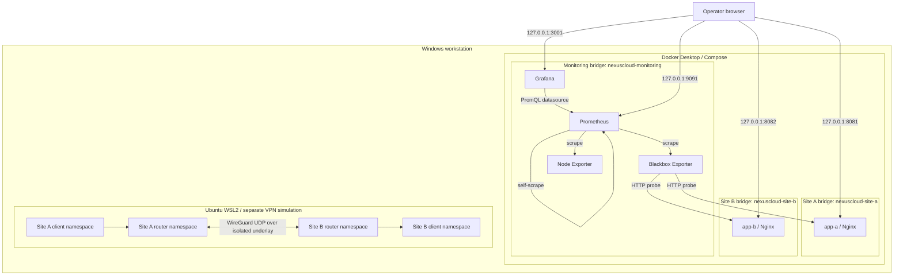

# System architecture

## 1. Purpose

The system is a local engineering lab with two deliberately separate network planes:

1. **Container plane:** two isolated Nginx application sites and a shared observability service network.
2. **Linux VPN plane:** two routed Linux site simulations connected with WireGuard inside Ubuntu WSL2.

The separation is intentional. It allows application segmentation and monitoring to be demonstrated without implying that Docker application traffic is protected by the separate VPN simulation.

## 2. Logical topology

## 3. Container network membership

| Service | Site A bridge | Site B bridge | Monitoring bridge |
|---|:---:|:---:|:---:|
| app-a | Yes | No | No |
| app-b | No | Yes | No |
| blackbox | Yes | Yes | Yes |
| prometheus | No | No | Yes |
| grafana | No | No | Yes |
| node-exporter | No | No | Yes |

Blackbox Exporter is multi-homed by design: it needs reachability to both application networks. Application containers do not share a network with each other. Grafana and Prometheus communicate over the monitoring network.

## 4. Host publication

Published service ports bind to the Windows/Docker host loopback interface:

| Host port | Container port | Service |
|---:|---:|---|
| 8081 | 80 | Site A |
| 8082 | 80 | Site B |
| 3001 | 3000 | Grafana |
| 9091 | 9090 | Prometheus |
| 9115 | 9115 | Blackbox Exporter |

The loopback binding limits access to the local host. It is not a substitute for application authentication, host security, or a production ingress design.

## 5. VPN simulation boundary

The VPN topology is implemented independently with Linux network namespaces. Site A and Site B routers communicate over an isolated underlay bridge and a WireGuard tunnel. Each router forwards traffic for a simulated client LAN.

The namespaces and their private keys are not Docker Compose services. Docker Desktop's application networks are not connected to these namespace LANs. A separate host or a deliberately engineered Docker/Linux routing integration would be required to prove application traffic over the VPN.

## 6. Design rationale

- Separate bridges reduce unnecessary east-west reachability.
- A dedicated monitoring bridge provides controlled multi-service observability.
- Blackbox probes test application behavior from the network, not merely container process state.
- Named volumes retain monitoring data across container recreation.
- Loopback-only port publication reduces accidental LAN exposure.
- The VPN namespace lab isolates routing experiments from the Docker application stack.

## 7. Failure domains

| Failure | Expected impact | Detection |
|---|---|---|
| Site A container stops | Site A unavailable; Site B unaffected | Health check and Site A probe alert |
| Site B container stops | Site B unavailable; Site A unaffected | Health check and Site B probe alert |
| Blackbox Exporter stops | Both HTTP probes stop reporting | Prometheus target health |
| Prometheus stops | Metrics and alert evaluation unavailable | Prometheus readiness endpoint |
| Grafana stops | Dashboard UI unavailable; scraping continues | Grafana health endpoint |
| WireGuard peer stops | Routed VPN traffic fails | Handshake age and client ping test |

## 8. Explicit non-goals

This build is not a public cloud deployment, production high-availability system, remote-site WAN VPN, Kubernetes platform, or security certification. It does not currently route the Nginx application traffic through WireGuard.
